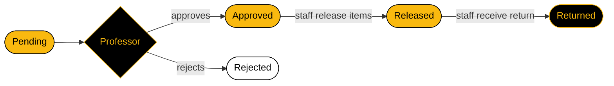

# OOP2-FINAL-PROJECT-GROUP3

  

  

  
  
  
  
  

 

## 📌 About the Project

In most school laboratories, borrowing equipment still means a paper slip: the student fills it out, hunts down the professor for a signature, brings it to the lab staff, and the staff writes it in a logbook. Slips get lost, handwriting is unreadable, and nobody can tell what is still available or who is holding what.

This PyQt6 desktop application keeps the **same borrowing steps**, but in one place. The student sends a slip, the professor approves or rejects it, and the laboratory staff release and receive the items while the inventory updates by itself.

> 🌍 Supports **SDG 9: Industry, Innovation, and Infrastructure** by replacing a paper logbook with a small, reliable software tool.

 

## 👥 Who Uses It

<table>
<tr>
<td width="33%" valign="top">

### 🎓 Student
- Logs in and fills out a borrow slip
- Picks items, quantities, purpose, and date needed
- Chooses which professor receives the slip
- Tracks the slip status

</td>
<td width="33%" valign="top">

### 👨‍🏫 Professor
- Logs in and sees slips sent to him or her
- Approves or rejects each slip
- Adds optional remarks

</td>
<td width="33%" valign="top">

### 🧑‍🔧 Laboratory Staff
- Logs in and sees approved slips
- Releases items against the student ID
- Receives returned items
- Adds, edits, and deletes equipment

</td>
</tr>
</table>

 

## 🔄 Slip Lifecycle

Releasing items lowers the available quantity. Receiving the return adds it back.

 

## ✨ Features

| | Feature | Description |
|:-:|---|---|
| 🔐 | **Role-based login** | Opens the dashboard that matches the user: student, professor, or staff |
| 📝 | **Borrow slip form** | Items, quantities, purpose, date needed, and the professor to send it to |
| 📊 | **Slip tracking** | Statuses: Pending, Approved, Rejected, Released, Returned |
| ✅ | **Approve or reject** | Professors review their slips with optional remarks |
| 📦 | **Release and return** | Staff verify the student ID, release items, and receive returns |
| 🗃️ | **Inventory management** | Add, edit, and delete equipment with total, available, and borrowed counts |
| 🔎 | **Search and filter** | Find slips by keyword or filter by status on every dashboard |
| 💾 | **Save and load** | Users, equipment, and slips are stored in `data.json` and kept after closing |
| 🧭 | **Menu bar and toolbar** | Save, Logout, Exit, and About for quick access |
| 🛡️ | **Input validation** | Blocks empty fields, zero or excessive quantities, and unavailable items |

 

## 🧰 Tech Stack

| Tool | Purpose |
|---|---|
| **Python** | Programming language |
| **PyQt6** | Graphical user interface |
| **QSS (Qt Style Sheets)** | White, yellow, and black theme |
| **json** | Saving and loading data |
| **PyInstaller** | Packaging as a Windows `.exe` |
| **Git and GitHub** | Version control and teamwork |

 

